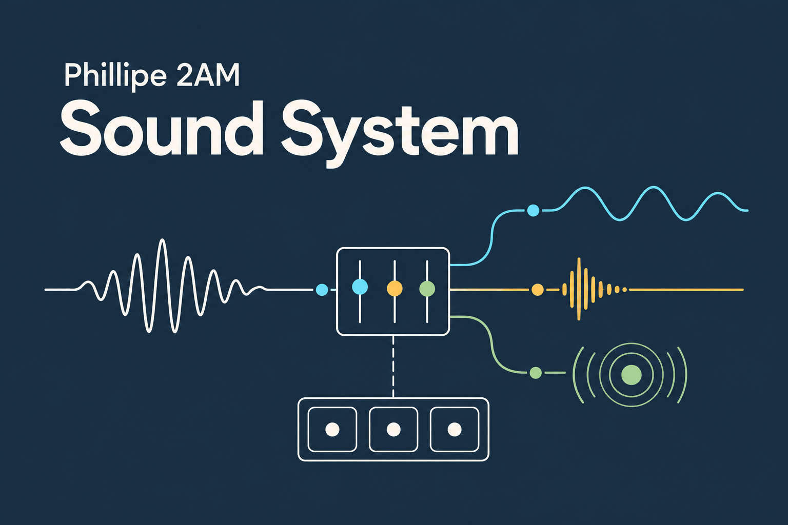

# Sound System

<p align="center"></p>

A reusable Unity audio runtime for mixer-routed playback, bounded source pooling, per-playback controls, spatial audio, and bus volume settings.

## Features

- Play 2D sounds, fixed-position 3D sounds, or sounds that follow a `Transform`.
- Control one playback with a handle, or control matching playback by bus or clip.
- Set looping, volume, pitch, and 3D falloff per request.
- Limit simultaneous sources with a pool that reuses slots and has a predictable overflow policy.
- Adjust bus volume from 0–100% or in decibels, with optional saved preferences.
- Pause and resume package playback when the application is suspended.

## Install

In Unity, open **Window > Package Manager**, select **+ > Add package from Git URL**, and enter:

```text
https://github.com/phillipeaam/unity-sound-system.git#v1.0.0
```

To follow the latest development changes instead, use `main`. It can change without a package release, so published projects should use a release tag or commit hash. The same stable URL can be added to `Packages/manifest.json`:

```json
{
  "dependencies": {
    "com.phillipe2am.soundsystem": "https://github.com/phillipeaam/unity-sound-system.git#v1.0.0"
  }
}
```

For development builds that intentionally track the moving branch, use:

```text
https://github.com/phillipeaam/unity-sound-system.git#main
```

## Get started

Create an `AudioMixer`, add its mixer groups as `AudioBusDefinition` assets, register those assets in an `AudioSystemConfiguration`, then assign that configuration to an `AudioManager` component on a root GameObject.

```csharp
using Phillipe2AM.SoundSystem;
using Phillipe2AM.SoundSystem.Configuration;
using UnityEngine;

public sealed class AudioCue : MonoBehaviour
{
    [SerializeField] private AudioClip _clip;
    [SerializeField] private AudioBusDefinition _bus;

    public void Play()
    {
        AudioManager.Instance?.TryPlay(_clip, _bus, out _);
    }
}
```

This example requests 2D playback. The full manual explains configuration, playback handles, delays and fades, volume persistence, pool limits, suspension, and 3D options.

## Sample

Import **Basic Audio Setup** from the package's **Samples** tab in Package Manager. The sample scene demonstrates the public API, volume sliders, playback handles, pool behavior, and fixed/followed 3D sounds.

The sample uses generated tones and example `Music`/`SFX` buses. Your project supplies its own mixer, buses, clips, scene, and UI.

## Documentation

- [User manual](Documentation~/index.md): setup, API behavior, examples, limits, and troubleshooting.
- [Performance guide](Documentation~/performance.md): measured costs, pool sizing, and measurement limits.
- [Maintainer guide](Documentation~/maintenance.md): code ownership, lifecycle invariants, and safe changes.
- [Changelog](CHANGELOG.md)

## Compatibility and license

Requires Unity 2023.1 or later and Unity's built-in Audio module. The runtime package does not add a third-party dependency.

MIT licensed. See [LICENSE.md](LICENSE.md).

If Sound System helps your project, mentioning it in your credits is appreciated, but entirely optional.
